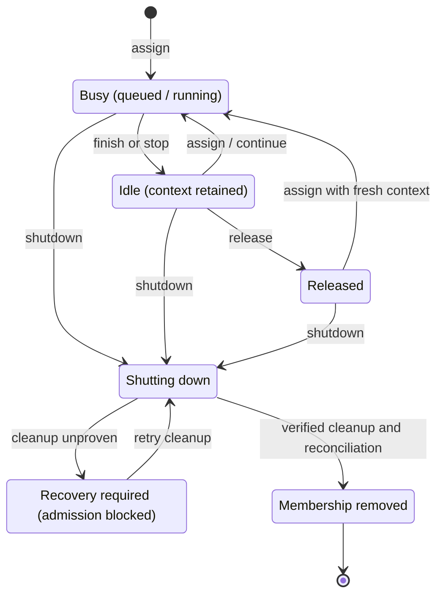
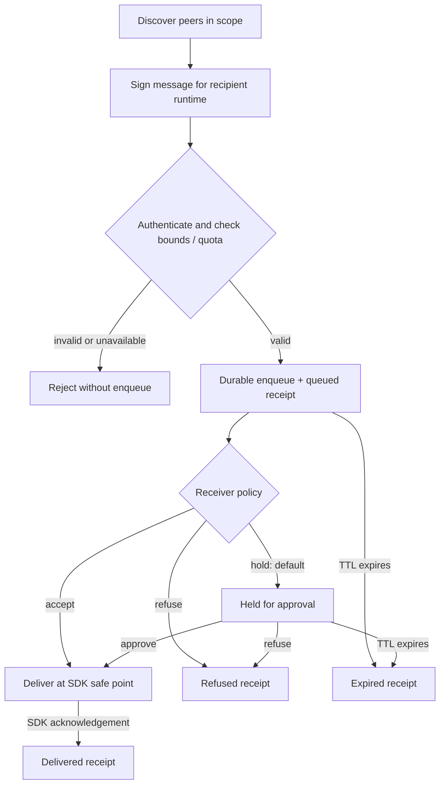

# @quandev104/pi-teams

[](https://github.com/quanpersie2001/pi-teams/actions/workflows/ci.yml)
[](https://pi.dev)
[](package.json)
[](LICENSE)

Delegate focused work to specialist agents running in independent Pi processes. Keep an eye on their progress, steer active work, and review results in one Team Hub—without turning your main conversation into a pile of parallel tasks.

https://github.com/user-attachments/assets/2f715c97-838d-461c-a6a2-7122ae26facf

## What you can do

- **Delegate independently:** run research, implementation, and review in separate Pi processes.
- **Stay in control:** inspect conversations and guide active work from the Team Hub.
- **Coordinate work:** use a session-scoped task board to track assignments and review completion.
- **Choose a specialist:** start with four bundled roles or define project-specific agents.
- **Share or isolate files:** agents use the shared workspace by default; optional worktree isolation is available.
- **Connect sessions:** opt-in peer messaging lets independent sessions exchange messages under receiver-controlled approval.

## Install

Requires **Node.js ≥22.19** and **Pi ≥1.0.4 and <1.1.0**.

```bash
pi install npm:@quandev104/pi-teams
```

## Quick start

Ask Pi to split a bounded feature into implementation and review, for example:

> Use a specialist to implement the missing validation in the account form, then ask a reviewer to inspect the diff for regressions. Report changed files and verification results.

Open `/agents` or press **Alt+G** to follow the work. Select an agent to read its conversation or send guidance. Press **Esc** to return; leaving the view does not stop the assignment. Open `/tasks` for the task board.

Agents run independently, but they **do not automatically inherit your conversation history**. Include the relevant goal, constraints, and context in the assignment. Agents use your shared workspace by default, so their file changes may affect the same checkout; choose worktree isolation when separate checkouts are appropriate.

## Bundled specialists

| Agent | Good for |
|---|---|
| `general-purpose` | Bounded multi-step research and implementation |
| `explore` | Finding local files and symbols |
| `scout` | Researching supplied external documentation links |
| `reviewer` | Independent review for correctness and regressions |

Create additional roles as Markdown agent definitions in `.pi/agents/`. Their available tools and behavior come from their definition; tool permissions are **not an operating-system sandbox**.

## Everyday controls

| Command or key | What it does |
|---|---|
| `/agents` | Open the Agents view |
| `/tasks` | Open the Tasks view |
| **Alt+G** | Toggle the Team Hub; reopening returns to the last-used tab |
| **Esc** | Leave a child view without stopping its work |
| `/teams-backend` | Show the current backend mode; use `/teams-backend auto` or `/teams-backend headless` to switch future children |
| `/agents teammate-status <name>` | Check a teammate's state |

## Teammate lifecycle

Stopping an assignment ends its current work; releasing a settled teammate clears its retained session; shutting down a teammate stops it and removes its membership. Session end cleans up child processes.

Named teammates can retain their session while idle. A later assignment continues that retained context by default; a released teammate starts fresh. For more control, see [configuration and agent definitions](docs/CONFIGURATION.md).



Reusing a name after shutdown creates a new membership; old messages and events cannot target it.

## Peer messaging

Peer messaging is opt-in (`peers.enabled` defaults to `false`). It connects independent sessions, not just teammates within one session; it does not grant ownership of another session's agents or tasks. Incoming messages are held by default until explicitly approved. Messages are untrusted content and cannot approve permissions. Windows peer messaging requires `pwsh` (PowerShell 7+) and verified per-user ACL/`CurrentUserOnly` support. Peer messaging is unavailable on hosts that do not meet these requirements.



A queued receipt confirms durable storage, not SDK delivery. Delivery is at-least-once: a missing acknowledgement is ambiguous, and retrying may duplicate delivery.

## Configuration and custom roles

The extension works without a settings file. For example, project settings can live in `.pi/teams.json`:

```json
{
  "maxConcurrent": 4,
  "backend": "auto",
  "defaultTimeout": 0
}
```

`defaultTimeout: 0` leaves the default run time limit unlimited. See the [configuration guide](docs/CONFIGURATION.md) for all settings and agent-definition options.

To have Pi create a focused specialist, use the bundled skill:

```text
/skill:create-agent Create a read-only API documentation reviewer
```

For delegation patterns and task-board workflows, try `/skill:team-lead`.

## Workspaces

Agents share the current workspace by default. Optional Git worktree isolation gives a run its own checkout; inspect and integrate its changes yourself. See [configuration](docs/CONFIGURATION.md) and [integration](docs/INTEGRATION.md) for details.

## Documentation

- [Documentation index](docs/README.md)
- [Configuration and agent definitions](docs/CONFIGURATION.md)
- [Agents UI](docs/ui/AGENT-PANEL-AND-VIEW.md)
- [Integration, tasks, and peer messaging](docs/INTEGRATION.md)
- [Architecture](docs/ARCHITECTURE.md)
- [Changelog](CHANGELOG.md)

When using the unified Tasks board, disable the separate legacy `pi-tasks` extension. For Pi's visual customization, see [pi-style](https://www.npmjs.com/package/@quandev104/pi-style). Licensed under [MIT](LICENSE).

## Development

```bash
npm ci
npm run check
npm run dev:pi
```
